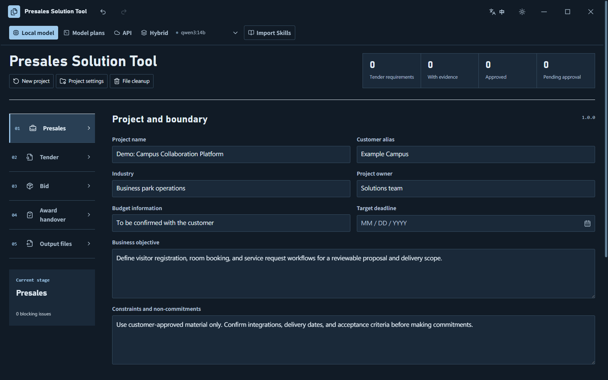
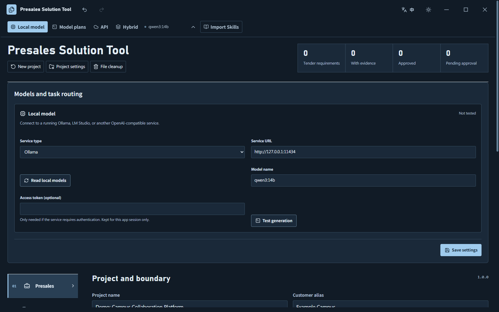
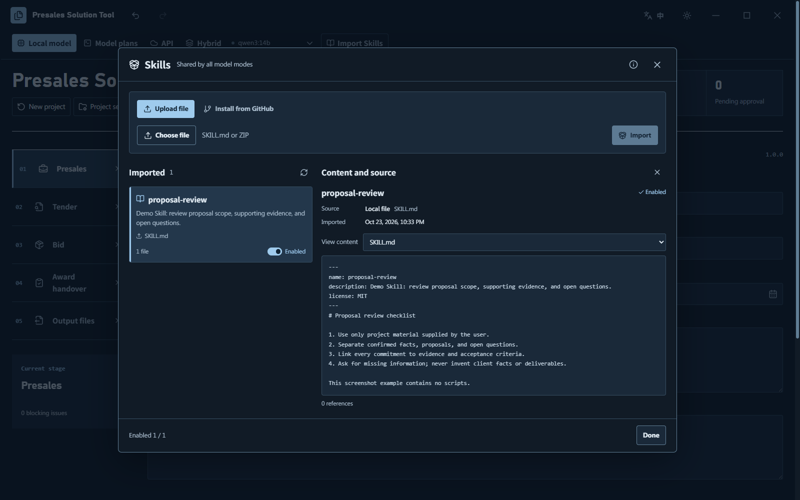
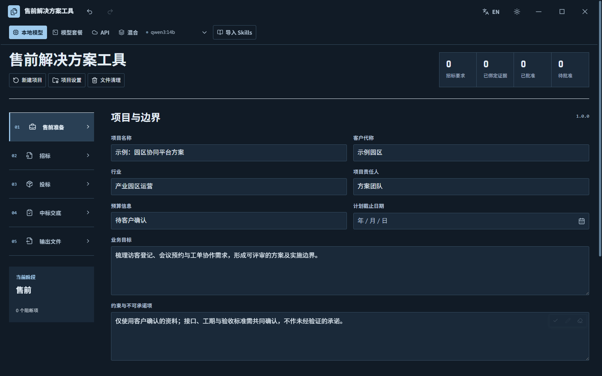
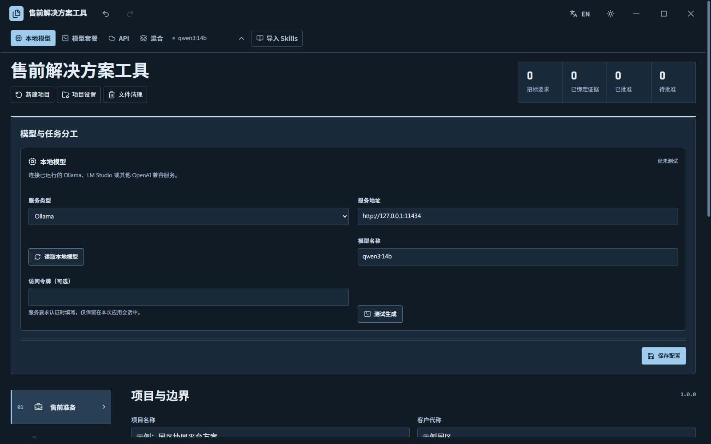
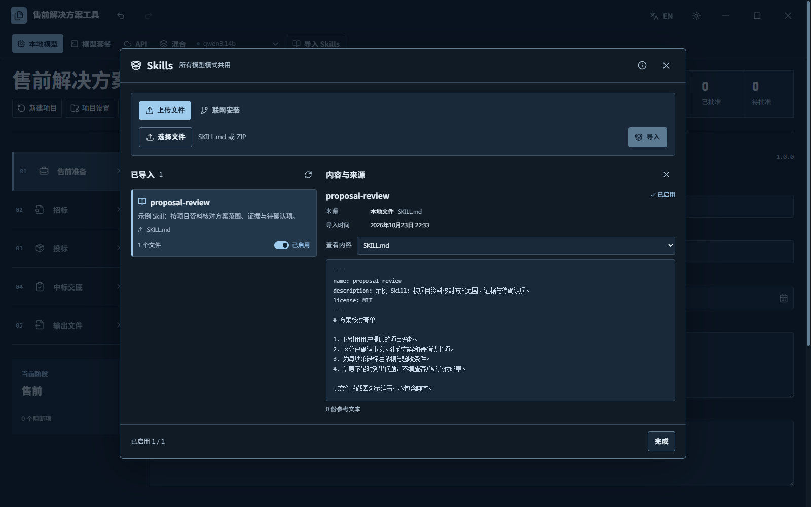

# 售前解决方案工具 · Presales Solution Tool

[简体中文](#user-content-presales-chinese) · [English](#user-content-presales-english)

<details name="readme-language">
<summary><strong>English</strong></summary>

<a name="presales-english"></a>
[简体中文](#user-content-presales-chinese) · **English**

A local Windows workspace for presales: organize customer requirements, review tender documents, prepare technical proposals, and track handover after a contract award. Project files stay in the folder you choose. Generation uses your configured local model or an authorized model service; review the results before use.

## Get started

1. Download the Windows x64 portable ZIP from [Releases](https://github.com/cavwic/presales-solution-tool/releases) and extract the entire archive.
2. Run `售前解决方案工具.exe` and choose a project folder.
3. Configure a model in the top bar, import your materials, and start working. The portable app includes its desktop runtime; Node.js and a web development server are not required.

Keep the extracted folder intact when moving the app. In a local source checkout, the root launcher opens `release/售前解决方案工具-win-x64/售前解决方案工具.exe`. See [releases and in-place updates](docs/releases.md) for the update process. Only the current stable installation and its portable ZIP are retained locally.

## Features

- Presales preparation, customer discussions, tender requirement analysis, technical proposal assembly, and project handover.
- Manage source materials, supporting evidence, templates, and generated files; export a folder or ZIP.
- Local models, model plans, API, and hybrid modes. Hybrid mode assigns a channel to each task; a failed request keeps its selected channel.
- Import a `SKILL.md`, a single-Skill ZIP, or a public GitHub Skill. Review and enable it once for use across all model modes.
- Chinese and English interfaces, light and dark themes, responsive windows, and file cleanup with selectable categories.

The app helps prepare and review documents. Users handle procurement portal submissions, signatures, and seals themselves.







*Screenshots use fictional demonstration data. They show the interface and workflow, not the quality of output for a real tender.*

## Models and data

| Mode | Connection |
| --- | --- |
| Local models | Ollama, LM Studio, and other OpenAI Chat Completions compatible services |
| Model plans | An already signed-in Codex client, a MiniMax subscription key, or a provider-authorized compatible endpoint |
| API | Your endpoint, model ID, and API key |
| Hybrid | Assign enabled channels separately to document analysis, file generation, and image recognition |

Provider presets include Claude, Gemini, Grok, DeepSeek, Qwen, Kimi, and GLM. A preset supplies connection defaults; it does not grant access or convert a web subscription into API credit. Billing and permitted use depend on the provider. See [model setup](docs/model-setup.md).

Project materials are stored in your chosen folder. App settings are stored under `%APPDATA%/CavwicBidWorkbench`. Requests send the current task materials and enabled Skill instructions to the selected model service. Keys entered in the app are held only for the current session and cleared on exit.

## Documentation and development

The following detailed guides are currently in Chinese.

- [Offline user guide](docs/使用说明.txt)
- [Model setup](docs/model-setup.md) · [Skills](docs/skills.md)
- [Development and builds](docs/development.md) · [Validation scope](docs/validation.md)
- [Releases and in-place updates](docs/releases.md) · [V1.6.0 release notes](docs/release-notes.md) · [Changelog](CHANGELOG.md)

```powershell
npm ci
npm run check
npm test
```

The development guide covers desktop packaging, runtime dependencies, and installed-app checks. Validation uses fictional projects and isolated settings. Passing these checks does not establish the quality of a proposal prepared for a real tender.

## License

Software code is licensed under [MIT](LICENSE). Project-authored Skills, documentation, and templates use [CC BY 4.0](CONTENT-LICENSE.md). Imported third-party content retains its original license.

[切换到简体中文](#user-content-presales-chinese)

</details>

<details name="readme-language" open>
<summary><strong>简体中文</strong></summary>

<a name="presales-chinese"></a>
**简体中文** · [English](#user-content-presales-english)

面向 Windows 的本地售前工作台，用于整理客户需求、分析招标文件、生成技术文件和跟踪中标交底。资料保存在所选项目目录，生成时使用自己配置的本地模型或授权模型接口；输出需人工复核。

## 开始使用

1. 从 [Releases](https://github.com/cavwic/presales-solution-tool/releases) 下载 Windows x64 便携包，完整解压。
2. 双击解压目录中的 `售前解决方案工具.exe`，选择项目目录。
3. 在顶部配置模型，导入资料后开始工作。便携版自带界面运行环境，无需 Node.js 或网页开发服务。

移动软件时保留完整目录。本机源码目录的根启动器会打开 `release/售前解决方案工具-win-x64/售前解决方案工具.exe`。原位更新见 [发行说明](docs/releases.md)；本机只保留当前稳定运行版及对应便携包。

## 功能

- 售前准备、客户沟通、招标要求分析、技术标组包与中标交底。
- 资料、参考依据、模板和生成文件统一管理，支持目录与 ZIP 输出。
- 本地模型、模型套餐、API、混合四种模式；混合模式按任务分工，请求失败时保留当前通道。
- 导入 `SKILL.md`、单 Skill ZIP 或公开 GitHub Skill，查看后启用，供所有模型模式共用。
- 中文和英文界面、深浅主题、自适应窗口，以及可选择范围的文件清理。

工具支持准备和审核文档；采购平台提交、签字和盖章由用户自行办理。







*截图使用虚构演示数据，只展示界面和操作，不代表真实项目的生成效果。*

## 模型和数据

| 模式 | 接入方式 |
| --- | --- |
| 本地模型 | Ollama、LM Studio、其他 OpenAI Chat Completions 兼容服务 |
| 模型套餐 | 已登录的 Codex、MiniMax 订阅 Key、厂商授权的兼容接口 |
| API | 自己配置的接口、模型 ID 与 API Key |
| 混合 | 为资料分析、文件生成和图像识别分别选择已启用通道 |

服务商预设包括 Claude、Gemini、Grok、DeepSeek、Qwen、Kimi、GLM 等。预设提供协议与地址，不代表取得调用授权，也不会把网页会员额度转换为 API 额度。接入和计费以服务商规则为准，具体见 [模型配置](docs/model-setup.md)。

项目资料保存在用户选择的目录；应用设置位于 `%APPDATA%/CavwicBidWorkbench`。请求会把当前任务资料和已启用的 Skills 指引交给所选模型服务。接口密钥只保留在当前应用会话，退出后清空。

## 文档与开发

- [离线使用说明](docs/使用说明.txt)
- [模型配置](docs/model-setup.md) · [Skills](docs/skills.md)
- [开发与构建](docs/development.md) · [验证范围](docs/validation.md)
- [发行与原位更新](docs/releases.md) · [V1.6.0 发行说明](docs/release-notes.md) · [变更记录](CHANGELOG.md)

```powershell
npm ci
npm run check
npm test
```

桌面构建、运行时依赖和安装后验证入口见开发文档。验证采用虚构项目及隔离配置；测试通过不等同于真实招标文件的内容质量验收。

## 许可

软件代码采用 [MIT](LICENSE)；本项目自有 Skill、说明和模板采用 [CC BY 4.0](CONTENT-LICENSE.md)。第三方导入内容保留其原许可。

[Switch to English](#user-content-presales-english)

</details>
