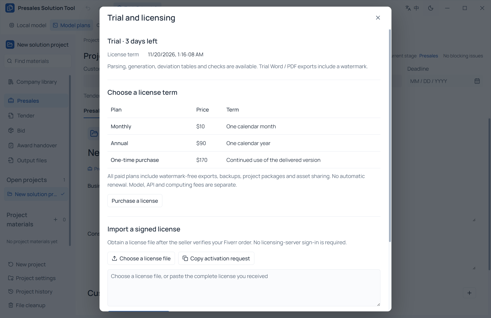
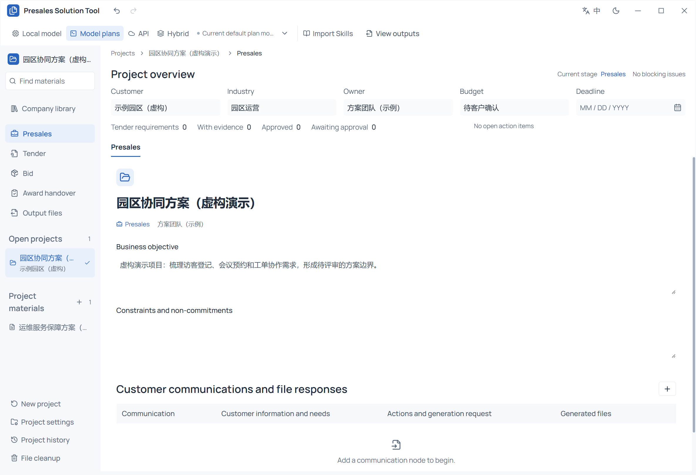
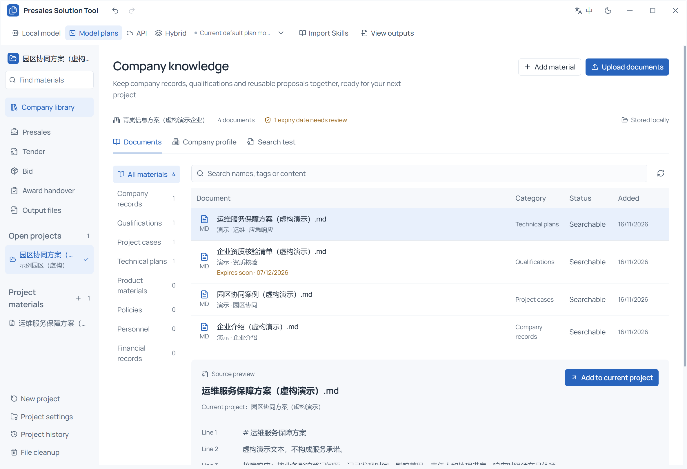
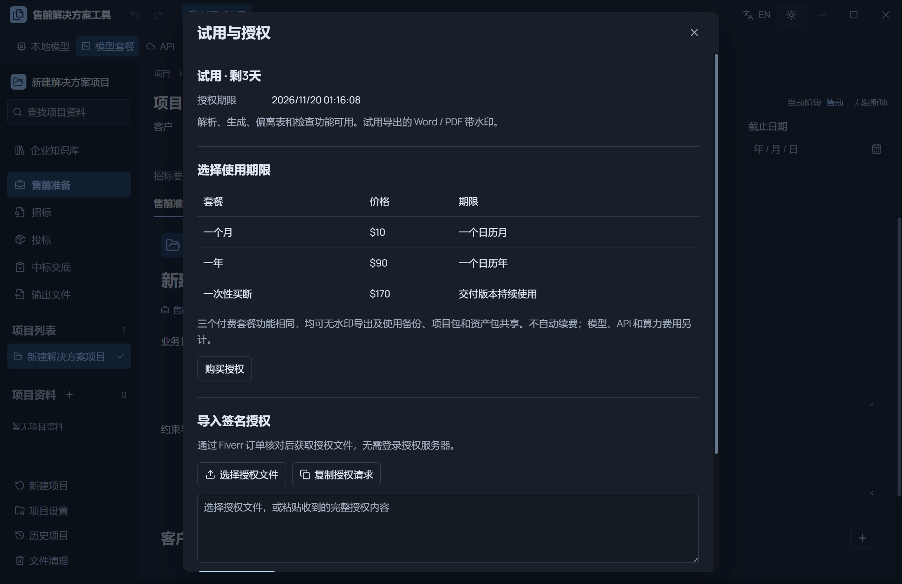
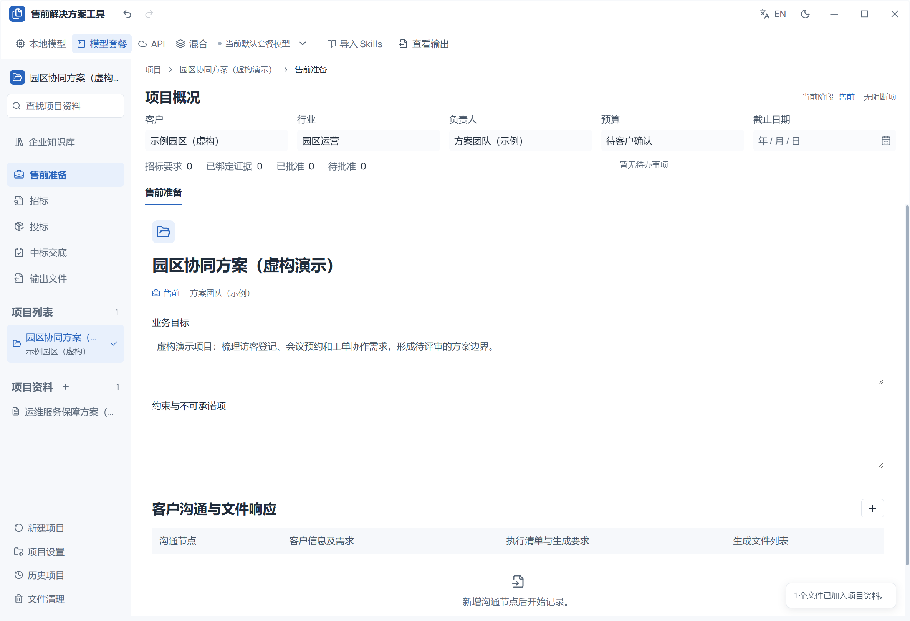
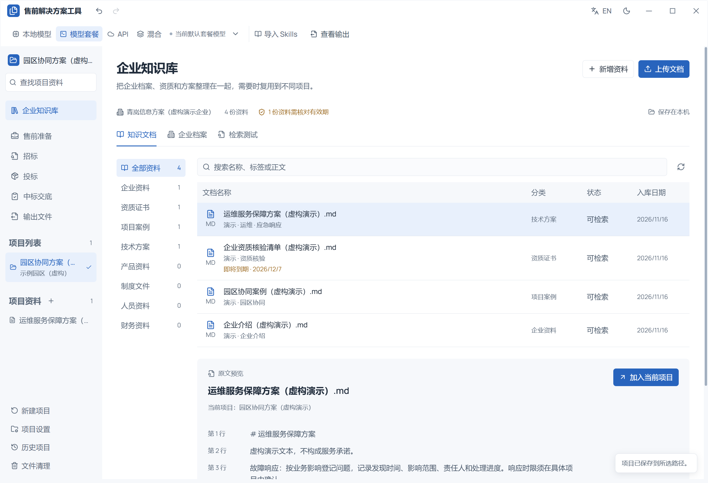

# Presales Solution Tool · 售前解决方案工具

[English](#user-content-presales-english) · [简体中文](#user-content-presales-chinese)

<strong>English</strong>

A Windows desktop workspace for customer discussions, tender analysis, proposal documents and award handover. Keep project files locally, maintain reusable company knowledge, and use the model service you configure.

**[Download the tool](https://www.fiverr.com/wencong_chen/provide-my-presales-solution-tool-for-your-windows-workflow)** · [First-use guide](docs/first-use.md#user-content-first-use-english) · [What's new](docs/updates.md#user-content-updates-english) · [Licensing](docs/licensing.md#user-content-licensing-english)

The download link opens the Fiverr service page, where delivery and licensing are arranged. This public repository contains product information, instructions and screenshots. It does not distribute the application, installers or commercial source code.

## Current version

**V1.11.0** adds a three-day trial, signed offline licensing, trial Word/PDF watermarks and paid backup/sharing controls to the existing five-stage workspace and company library.

| Plan | Price | Included use |
| --- | --- | --- |
| Three-day trial | Free | Existing parsing, generation, deviation tables and checks for 72 hours; watermarked Word/PDF exports |
| Monthly | **$10** | All paid features for one calendar month |
| Annual | **$90** | All paid features for one calendar year |
| One-time purchase | **$170** | Continued use of the delivered version within the licensed version range |

All paid plans include exports without the trial watermark, whole-library backups, project-package import/export and company-asset packages. Trial users cannot use backup/package/sharing features. After expiry, saved projects/files remain viewable; importing a valid license restores editing and generation. No automatic renewal or model/API credits are included. [Compare features and activation](docs/licensing.md).

- **Company records:** keep a company profile and organize qualifications, project cases, technical plans, products, policies, personnel and financial materials.
- **Traceable documents:** upload files or add reusable text, maintain tags and expiry dates, and inspect the original text with its file and page, paragraph or line location.
- **Local keyword search:** test a search against parsed document excerpts and open a result's source. Search runs locally without calling a model or embedding service.
- **Reuse in a project:** add a selected company document to the current project as an independent copy. Choose it as a reference in the workflow stage that needs it.
- **Keep working across projects:** switch between opened projects, find saved work in history, and keep each project's materials and generated files separate.

The workflow remains **Presales → Tender → Bid → Award handover → Output files**. Local models, authorized model plans, API and hybrid routing share the existing Skills controls. English/Chinese, light/dark themes and resizable frameless windows remain available.

## Install and start

1. Obtain the current installer through **Download the tool**. Online installer size: **2,128,384 bytes** (about **2.13 MB**).
2. Run it, choose an installation folder and allow it to download and configure the required desktop runtime. **An internet connection is required for the separate 157,998,329-byte runtime download** (about 158 MB). The installed program occupies about 342 MB, before your project files, libraries and temporary setup files. The small installer is not a complete offline package.
3. Open the desktop shortcut to begin the 72-hour trial, create a project and configure a compatible model. For paid use, import the signed file issued after the seller verifies your Fiverr order in **Trial and licensing**. You do not need Node.js, a development server or a licensing-server login.

Start with the [first-use guide](docs/first-use.md). Software delivery does not include model access, API credits or computing resources. Model services and any usage charges are your responsibility.

## Screenshots

The licensing screen above is from V1.11.0. The earlier workflow screens below remain available as historical references.

[Company profile](images/company-profile.en.png) · [Keyword search and sources](images/knowledge-search.en.png) · [Model settings](images/model-settings.en.png)

These workspace and company-library screenshots were captured in **V1.10.4**, before the V1.11.0 licensing controls; they are historical interface references. They use fictional materials, not real qualifications, customer deliveries or verified model output. User-entered names and content are not translated when changing interface language.

## Data and licensing

The project library and company knowledge library are separate local folders. Use the app's folder controls to find their actual locations, and back them up with any external project folders before moving or updating the app. Settings remain in `%APPDATA%\CavwicBidWorkbench`.

Adding a file to a library does not automatically send it to a model. Analysis and generation send the selected task materials and enabled Skill instructions to the service you configure. Search, file organization and source previews work locally. The app does not submit bids to procurement portals or apply signatures or seals.

Commercial delivery and use follow the applicable order and [licensing terms](docs/licensing.md). This repository does not grant access to the commercial source code. Earlier separately granted licenses and third-party licenses remain applicable to their covered materials.

Licenses are manually issued as signed files; there is no automatic Fiverr-payment integration. License-file signing is separate from Windows installer/EXE code signing, which has not been implemented. Local licensing checks are not a guarantee against program modification or trial-state resets.

<strong>简体中文</strong>

面向 Windows 的本地售前工作台，用于客户沟通、招标分析、方案文件编制和中标交底。项目资料保存在本机，企业资料可整理后复用，生成时使用自己配置的模型服务。

**[工具下载](https://www.fiverr.com/wencong_chen/provide-my-presales-solution-tool-for-your-windows-workflow)** · [首次使用](docs/first-use.md#user-content-first-use-chinese) · [版本功能](docs/updates.md#user-content-updates-chinese) · [授权说明](docs/licensing.md#user-content-licensing-chinese)

“工具下载”跳转至 Fiverr 服务页面，通过该页面安排工具交付和授权。本公开仓库仅提供产品介绍、使用说明和截图，不提供程序、安装包或商业源代码下载。

## 当前版本

**V1.11.0** 在现有五阶段工作台和企业知识库基础上，增加三天试用、离线签名授权、试用 Word／PDF 水印，以及付费备份与共享权限。

| 套餐 | 价格 | 使用范围 |
| --- | --- | --- |
| 三天试用 | 免费 | 72小时内使用现有解析、生成、偏离表和检查，Word／PDF 导出带水印 |
| 一个月 | **$10** | 一个日历月内使用全部付费功能 |
| 一年 | **$90** | 一个日历年内使用全部付费功能 |
| 一次性买断 | **$170** | 持续使用授权版本范围内的交付版本 |

三个付费套餐功能相同，均支持不带试用水印的导出、整库备份、项目包导入导出和企业资产包。试用用户不可备份或共享；到期后已有项目和文件仍可查看，导入有效授权后恢复编辑和生成。不自动续费，不含模型／API额度。[功能对比与激活](docs/licensing.md)。

- **企业档案与分类资料：** 维护企业基本信息，按资质、案例、技术方案、产品、制度、人员和财务分类整理资料。
- **文档与出处：** 上传文件或直接录入常用文字，设置标签、备注和有效期，查看原文及文件名、页码、段落或行号。
- **本地关键词检索：** 查找已解析的正文片段，并从结果回到原文；检索不调用模型或嵌入服务。
- **复用到当前项目：** 将选中的企业资料复制到当前项目，各阶段再按需选为参考资料。企业库原件和项目副本独立保存。
- **多项目工作：** 切换已打开项目，在历史项目中查找已保存的工作，各项目资料与生成文件独立管理。

业务流程仍为 **售前准备 → 招标 → 投标 → 中标交底 → 输出文件**。本地模型、授权模型套餐、API、混合路由和 Skills 沿用原有入口，同时保留中英文、深浅主题及无边框窗口自适应。

## 安装与开始使用

1. 通过“工具下载”获取当前安装包。在线安装器体积为 **2,128,384 字节**（约 **2.13 MB**）。
2. 运行安装器，选择安装位置，按提示下载并配置桌面运行环境。**安装时需联网另行下载157,998,329字节的运行环境**（约158 MB）。程序安装后约占342 MB，项目文件、资料库及安装临时文件需另留空间。小型引导安装器不是完整离线包。
3. 从桌面快捷方式打开工具开始72小时试用，新建项目并配置兼容模型。付费后，在卖家核实 Fiverr 订单并提供签名文件后，到“试用与授权”中导入。无需另装 Node.js、手工启动开发服务器或登录授权服务器。

完整操作见[首次使用说明](docs/first-use.md)。软件交付不包含模型访问、API 额度或算力；模型服务及其费用由使用者自行配置和承担。

## 工具截图

上图为V1.11.0真实授权界面，下方旧流程截图保留为历史参考。

[企业档案](images/company-profile.zh.png) · [关键词检索与原文](images/knowledge-search.zh.png) · [模型设置](images/model-settings.zh.png)

这些工作台和企业库截图拍摄于 **V1.10.4**，是 V1.11.0 授权功能加入前的历史界面参考。截图使用虚构资料，不代表真实资质、客户交付或已验证的模型输出质量。切换界面语言不会翻译用户录入的名称和正文。

## 资料与授权

项目资料库与企业知识库分别保存在本机文件夹中，可通过工具内的目录按钮查看实际位置。移动或更新工具前，请同时备份这两个库及外部项目目录。应用设置保存在 `%APPDATA%\CavwicBidWorkbench`。

仅将文件存入资料库不会自动发送给模型。执行分析或生成时，工具按当前任务选择的资料和已启用的 Skill 指引调用所配置的服务；检索、文件整理和原文预览在本地完成。工具不代替使用者向采购平台提交标书，也不执行签字、盖章。

商业交付及使用范围以适用订单和[授权条款](docs/licensing.md)为准。本仓库不提供商业源代码使用许可；历史已授予的许可及第三方许可继续适用于各自覆盖的内容。

授权文件由人工核单后签发，未接入 Fiverr 自动付款接口。授权文件签名与 Windows 安装器／EXE代码签名不同，后者尚未实施。本地授权检查不保证能够防止修改程序或重置试用状态。

