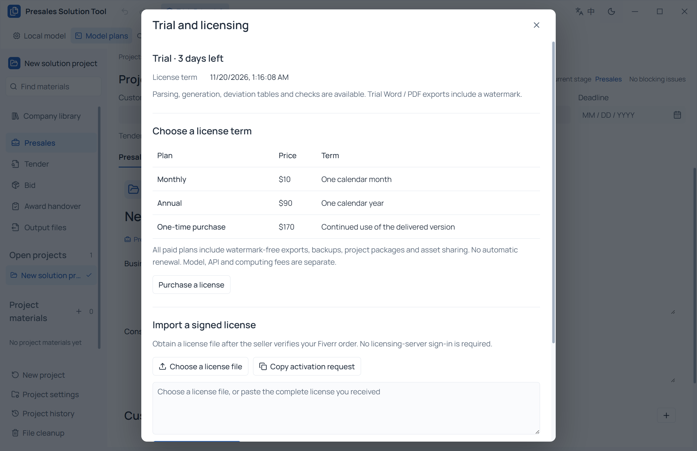
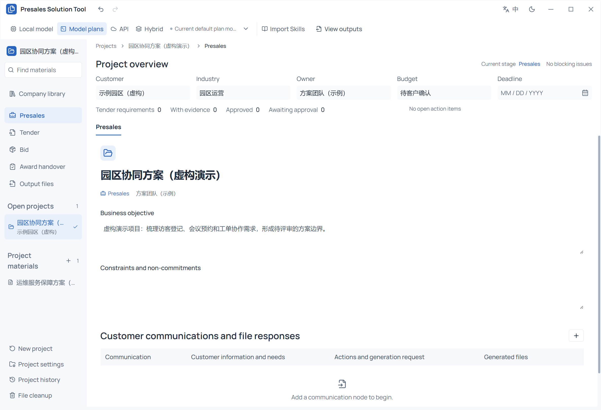
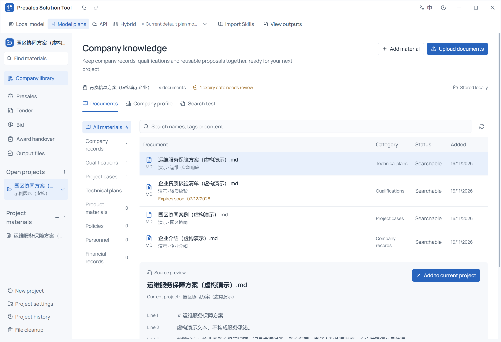
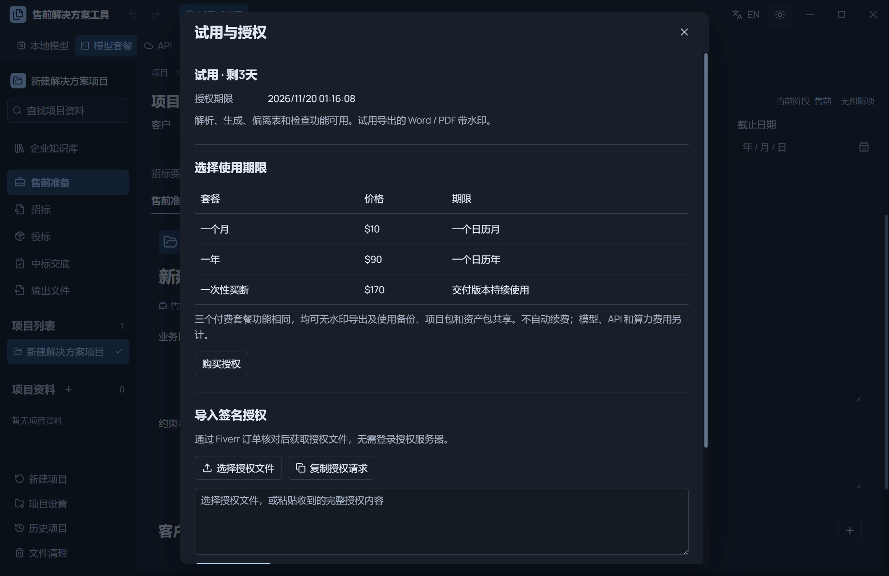
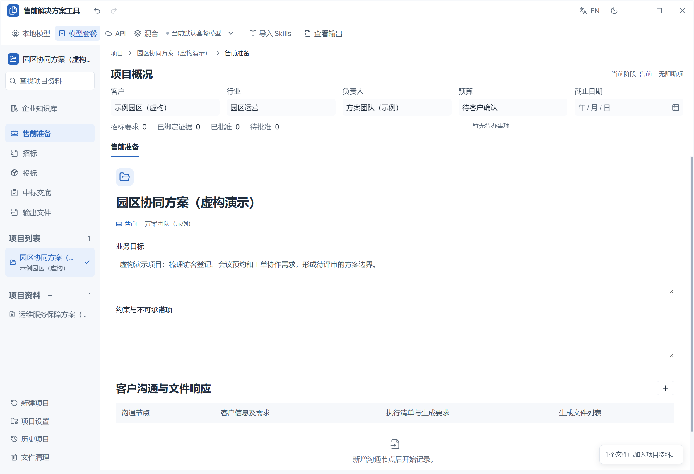
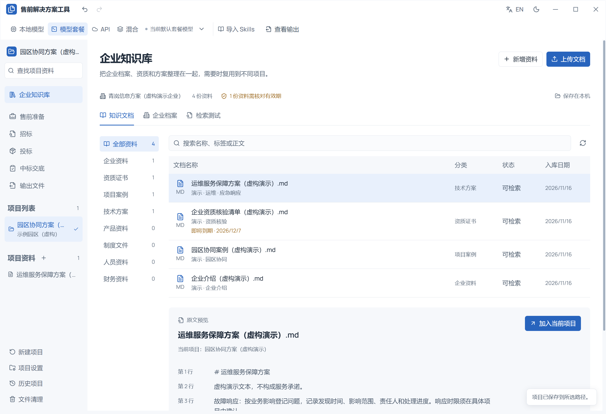

# What's new · 版本功能

**V1.11.0** · [English](#user-content-updates-english) · [简体中文](#user-content-updates-chinese) · [Product home](../README.md)

<strong>English</strong>

## Trial and licensing

- First local launch starts a **72-hour trial**. Existing parsing, generation, deviation-table and checking workflows are available during it.
- Trial Word/PDF exports carry a visible watermark. Active paid licenses enable exports without the trial watermark and unlock whole-library backups, project-package import/export and company-asset packages.
- Expiry switches to viewing existing projects and files. A valid license restores editing and generation; expiry does not delete materials.
- Plans are **$10/month**, **$90/year**, and **$170 one-time** for the delivered version range. Paid features are identical. Calendar terms do not renew automatically, and model/API fees are excluded.
- The seller manually verifies the Fiverr order and issues an **Ed25519-signed file**. Import it in **Trial and licensing**. The client contains the public key only; there is no automatic payment API or licensing server.

Local protection and clock checks are not a guarantee against modifying the program, resetting state or reinstalling. This release does not add Windows installer/EXE code signing; that requires a separate real certificate or signing service. [License details](licensing.md).

## PDF export and paid packages

**Export project PDF** creates an A4 document from the project's Markdown text, not a layout-preserving conversion of a Word template. Paid users can re-export without another model call. Historical PDF watermarks are not removed losslessly; create a new export from the project text. Source files are not changed.

**Back up libraries** creates a ZIP snapshot of the managed project and company libraries, with file-size and SHA-256 records for manual recovery. External project directories and AppData model settings are excluded. **Share company assets** includes active company records and originals only; removed/archived company records are excluded. It is offline file sharing with confirmation, not cloud collaboration.

The five stages, company library, model channels, Skills, project switching and responsive window remain available within their license state. Existing local data locations are retained. See [first use](first-use.md) for the steps.

## Installation and screenshots

The small online installer configures the runtime separately; its measured size is listed on the [product home](../README.md). It is not an offline application bundle. Node.js or a development server is not required for the installed app.

The following images were captured in **V1.10.4**, before the licensing controls. They remain historical references for the existing workspace and company library, not evidence of the V1.11.0 authorization screen.

[Company profile](../images/company-profile.en.png) · [Keyword search and sources](../images/knowledge-search.en.png) · [Model settings](../images/model-settings.en.png)

Screenshots use fictional demonstration materials, not real credentials, customer deliveries or verified model output. This public repository publishes product information, instructions, licensing and screenshots only. **[Download the tool](https://www.fiverr.com/wencong_chen/provide-my-presales-solution-tool-for-your-windows-workflow)** opens the Fiverr service page.

<strong>简体中文</strong>

## 试用与授权

- 首次本机启动起提供 **72小时免费试用**，试用期内可用现有解析、生成、偏离表和检查流程。
- 试用 Word／PDF 导出带可见水印。有效付费授权可无试用水印导出，并使用整库备份、项目包导入导出和企业资产包。
- 到期后仅查看已有项目和文件；导入有效授权后恢复编辑与生成，不因到期删除资料。
- 月度 **$10**、年度 **$90**、一次性买断 **$170**。付费功能相同，买断覆盖所交付版本范围；月／年按日历计算，不自动续费，不含模型／API费用。
- 卖家人工核实 Fiverr 订单后提供 **Ed25519签名授权文件**，在“试用与授权”中导入。客户端只带公钥，未接入自动付款接口或授权服务器。

本机状态保护和回拨检查不保证防破解，不能彻底防止修改程序、重置状态或重装。本版没有增加 Windows 安装器／EXE代码签名；后者需另备真实证书或签名服务。详见[授权说明](licensing.md)。

## PDF 导出与付费打包

“导出项目 PDF”按项目 Markdown 正文重排为 A4，不是 Word 模板的原版式保真转换。付费后可以直接重导，不再调用模型。历史 PDF 的水印不会无损自动消失，应从项目正文重新导出；源文件不修改。

“整库备份”生成工具管理的项目库和企业库 ZIP 快照，附带文件大小及 SHA-256 记录，供手动恢复，不包含外部项目目录或 AppData 模型配置。“分享企业资产包”只包含仍在库中的企业档案、资料及原件，不带已移除的归档资料。这是用户确认后的离线文件共享，不是云端协作。

五阶段、企业库、模型通道、Skills、多项目切换和窗口自适应继续按授权状态可用；已有本机数据位置沿用，步骤见[首次使用](first-use.md)。

## 安装与截图

小型在线安装器会单独配置运行环境，实测体积见[产品首页](../README.md)。它不是完整离线包；安装后的工具无需另装 Node.js 或开发服务器。

以下截图拍摄于 **V1.10.4**，是授权功能加入前的工作台和企业库历史参考，不当作 V1.11.0 授权界面的证据。

[企业档案](../images/company-profile.zh.png) · [关键词检索与出处](../images/knowledge-search.zh.png) · [模型设置](../images/model-settings.zh.png)

截图使用虚构示例资料，不代表真实资质、客户交付或已验证的模型输出。公开仓库只更新产品说明、首用步骤、授权和截图。通过 **[工具下载](https://www.fiverr.com/wencong_chen/provide-my-presales-solution-tool-for-your-windows-workflow)** 跳转 Fiverr 服务页面。

